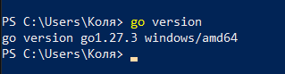
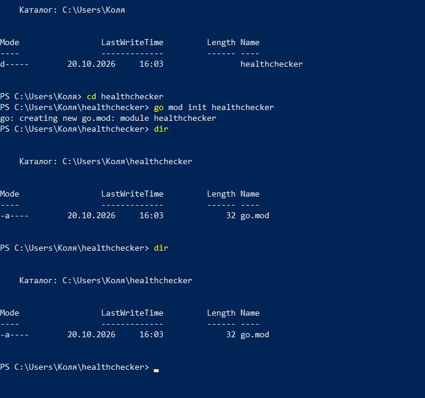
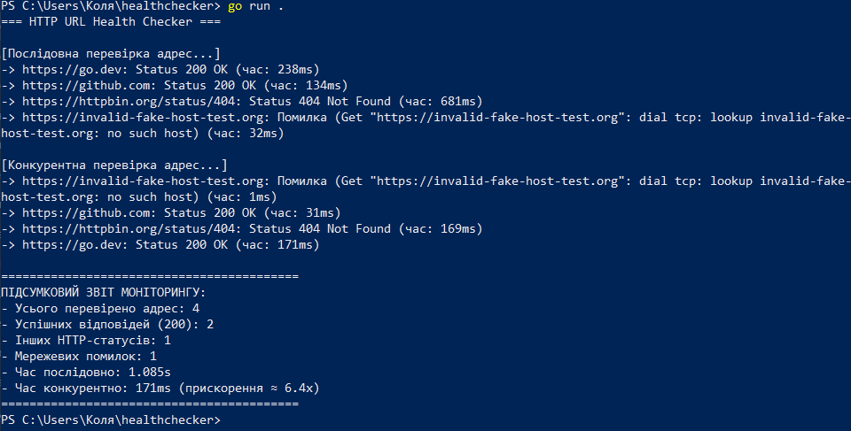
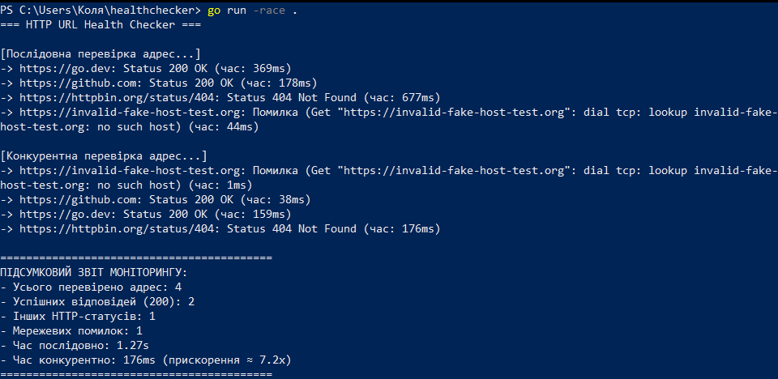

# HTTP URL Health Checker

**Практична робота № 1.** Базові конструкції, структури даних та конкурентність у Go.

Консольна утиліта, яка перевіряє доступність HTTP-ресурсів. Виконано **Рівні 1 та 2**.

## Що реалізовано

**Рівень 1: структури, інтерфейс, послідовний моніторинг**
- `Result`: структура результату (URL, статус-код, тривалість, помилка).
- `Checker`: інтерфейс з методом `Check(url string) Result`.
- `HTTPChecker`: структура з `*http.Client` (таймаут 5 с), неявно реалізує `Checker`; час вимірюється через `time.Now()` / `time.Since()`.
- `runSequential`: послідовне опитування 4 адрес (go.dev, github.com, httpbin.org/status/404 та неіснуючий домен).

**Рівень 2: горутини, WaitGroup, Mutex**
- Кожен URL перевіряється в окремій горутині, адреса передається аргументом.
- `wg.Add(1)` перед запуском, `defer wg.Done()` усередині, `wg.Wait()` у головному потоці.
- Структура `Stats` з лічильниками, захищеними `sync.Mutex`.
- Перевірка `go run -race .` без `DATA RACE`.

## Вимоги

- Go 1.22 або новіший (перевірено на 1.27.3, Windows)
- Для `-race` на Windows потрібен C-компілятор (cgo), наприклад WinLibs (GCC)

## Запуск

```bash
go run .
go run -race .
```

## Скриншоти

**1. Версія Go (`go version`)**



**2. Створення проєкту (`go mod init`, `dir`)**



**3. Запуск програми (`go run .`)**



**4. Перевірка на стан гонитви (`go run -race .`), без `WARNING: DATA RACE`**



## Порівняння часу

| Режим | Час |
|:--|:--|
| Послідовний | 1085 мс |
| Конкурентний | 171 мс |
| Прискорення | ≈ 6.4× |

## Відповіді на контрольні питання

1. **Неявна реалізація інтерфейсів vs `implements`.** У Go тип задовольняє інтерфейс, якщо має всі його методи; нічого явно оголошувати не потрібно. У Java/C# клас мусить явно вказати `implements` або `: IInterface`. У Go це знижує зв'язність: інтерфейс можна описати вже після типу, навіть для типів із чужих пакетів.
2. **Value vs pointer receiver.** Value receiver отримує копію значення, зміни в методі не впливають на оригінал. Pointer receiver отримує вказівник, може змінювати оригінал і не копіює велику структуру. Якщо методи інтерфейсу оголошені з pointer receiver, інтерфейс задовольняє саме `*T`, а не `T` (як `*HTTPChecker` у цій роботі).
3. **Чому 1000 горутин не вичерпують пам'ять.** Горутина починає зі стека близько 2–4 КБ, який росте за потреби, а керує ними планувальник Go у користувацькому просторі, мультиплексуючи на невелику кількість потоків ОС. Потік ОС займає близько мегабайта стека та має дорогі перемикання контексту ядром.
4. **Race condition і `-race`.** Це ситуація, коли кілька горутин одночасно звертаються до однієї змінної, принаймні одна пише, а результат залежить від порядку виконання. Прапорець `-race` вмикає детектор, що під час виконання відстежує доступи до пам'яті та виводить `WARNING: DATA RACE` зі стеками обох горутин.
5. **`sync.WaitGroup` і `Add()` перед `go`.** Призначена для очікування завершення групи горутин. Якщо викликати `Add()` всередині горутини, `Wait()` у головному потоці може виконатися раніше, ніж горутина збільшить лічильник, і програма завершиться передчасно.
6. **`Mutex` vs `chan`.** М'ютекс блокує доступ до спільної пам'яті: усі горутини бачать одні дані, але по черзі. Канал передає володіння даними: значення відправляється іншій горутині, і спільного стану немає (принцип «діліться пам'яттю, спілкуючись»).
7. **Закритий канал.** Відправка в закритий канал та повторний `close()` викликають `panic`. Читання із закритого каналу не панікує: повертає решту буфера, потім нульові значення (`ok == false`).

## Висновки

Реалізовано утиліту для перевірки доступності HTTP-ресурсів. Рівень 1: структури, інтерфейс з неявною реалізацією, обробка помилок, замір часу. Рівень 2: запити розпаралелено горутинами, завершення синхронізовано через `sync.WaitGroup`, спільну статистику захищено `sync.Mutex`; `go run -race .` підтвердив відсутність стану гонитви. Конкурентний режим триває приблизно стільки, скільки найповільніший запит, тому він помітно швидший за послідовний.
